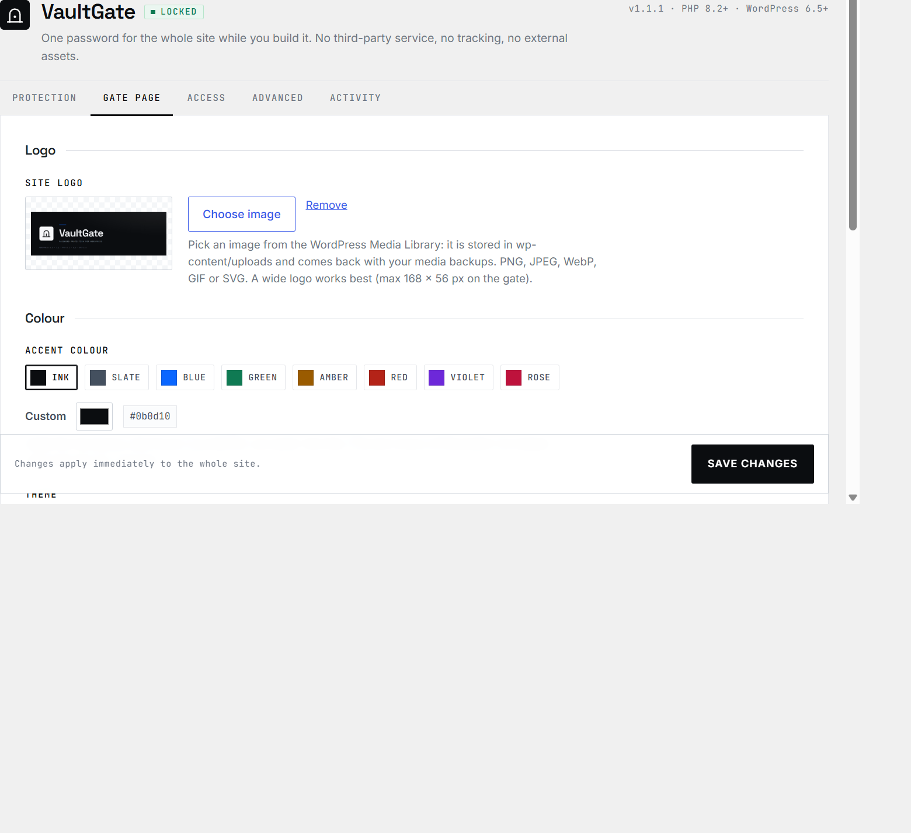
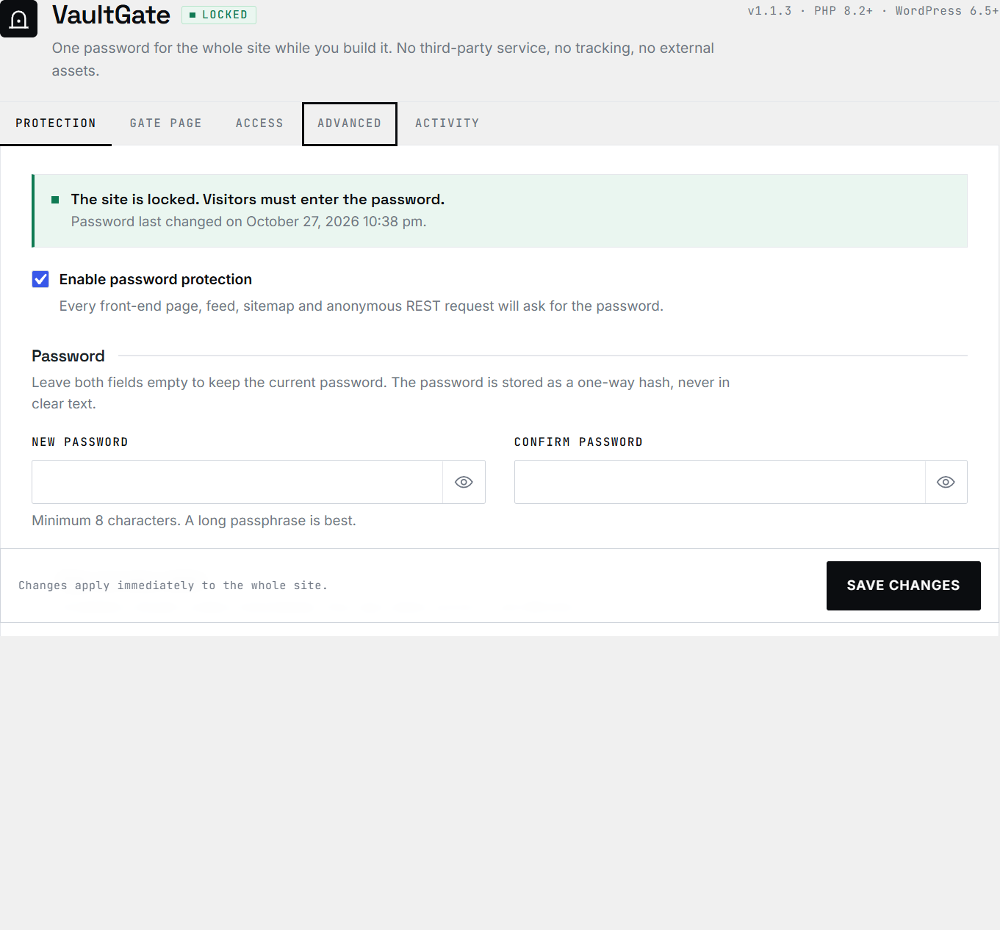
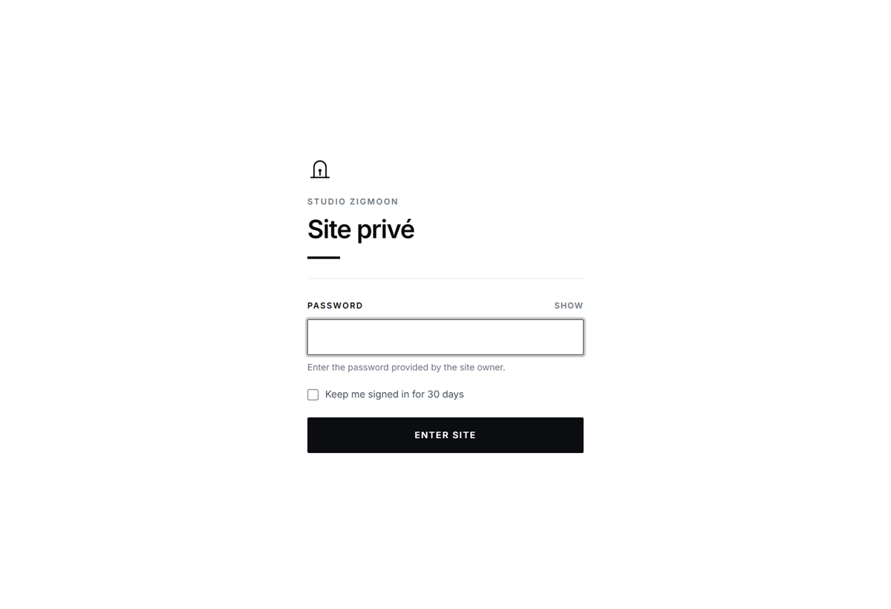
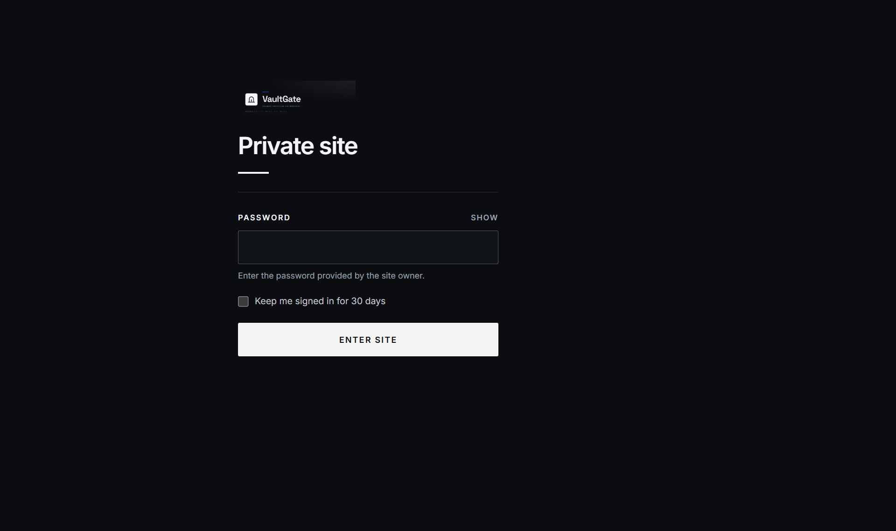
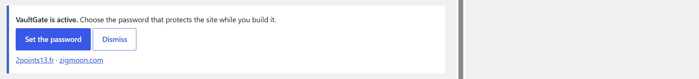
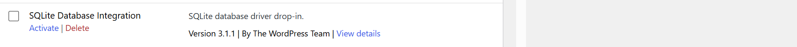

<p align="center">
  
</p>

<h1 align="center">VaultGate</h1>

<p align="center">
  <b>One password for the whole site — nothing else on the page.</b><br>
  A quiet WordPress plugin for sites that are still being built.
</p>

<p align="center">
  <a href="README.md"><b>English</b></a> ·
  <a href="README.fr.md">Français</a> ·
  <a href="README.es.md">Español</a>
</p>

<p align="center">
  <a href="https://github.com/zigmoon/passwordprotect/releases/latest"><b>⬇ Download</b></a> ·
  <a href="#install">Install</a> ·
  <a href="#what-you-get">What you get</a> ·
  <a href="#credits">Credits</a>
</p>

<p align="center">
  
  
  
  
  
</p>



## What you get

**Settings → VaultGate** — five tabs, no noise: **Protection**, **Gate page**, **Access**, **Advanced**, **Activity**.



- **One password, everything closed.** Pages, archives, feeds, sitemaps, the REST API, anonymous AJAX and XML-RPC — each with its own switch.
- **Your logo, your colour.** Logo picked from the Media Library (`wp-content/uploads`), eight accent swatches or any hex, light / dark / system gate. Contrast is computed, never guessed.
- **Nothing you did not write.** No marketing sentence, no support link, no footer on the gate. A logo, a title, a field, a button.
- **No third party.** Fonts, icons and styles live inside the plugin. No Google Fonts, no CDN, no analytics, no outbound request.
- **Signed cookies, not sessions.** HMAC-SHA256, `HttpOnly`, `SameSite`; one click revokes every visitor.
- **Built to be removed.** No table, no `.htaccess`, no rewrite rule. Deactivate and the site is public again.

## The gate

| Light | Dark |
|---|---|
|  |  |

One column, centred from 320 px up, and it works without JavaScript.

## Install

1. Download `vaultgate-1.1.1.zip` from [Releases](https://github.com/zigmoon/passwordprotect/releases/latest).
2. **Plugins → Add New → Upload Plugin**, choose the ZIP, install, activate.
3. **Settings → VaultGate**: set the password, then turn protection on.

Or from a checkout:

```bash
cp -r vaultgate /path/to/wp-content/plugins/
wp plugin activate vaultgate
wp vaultgate password 'a long passphrase'
wp vaultgate enable
```

WordPress 6.5+ and PHP 8.2+ — nothing else to install. The first activation shows a single notice pointing at the password field: dismissable.



## Quality

- **Latest WordPress, latest PHP.** WordPress 6.5 → 7.1, PHP 8.2 → 8.5, no deprecated call, no bundled library. Translations load on `init`, as WordPress 6.7+ requires.
- **181 assertions.** Two suites (`php tests/run.php`, `php tests/smoke.php`) on PHP 8.3 and 8.5, with no WordPress installation.
- **Checked on a real install.** Every surface probed on WordPress 7.1.3 / PHP 8.3: front, posts, feeds, sitemaps, REST, AJAX, XML-RPC, `robots.txt`, `wp-login.php`, admin, activation and deletion.
- **Responsive back office.** The settings screen is usable down to 360 px; the gate is centred at every width.

## Limits

- **Static files.** `wp-content/uploads/...` is served by the web server and never reaches WordPress. Use server authentication for sensitive files.
- **Page cache.** The gate sends `no-store` and checks the cookie on every request; exclude the site from an external full-page cache while it is locked.
- **`wp-login.php` stays open.** It is the way back in: administrator sessions always bypass the gate.
- **One shared password.** Not a user or role manager.

## Removing it

Deactivating makes the site public again and revokes every issued cookie. Deleting the plugin removes its settings, hash and log — **on by default** — so nothing is left behind. If you ever get stuck: `define( 'VAULTGATE_DISABLED', true );` in `wp-config.php`, or `wp vaultgate disable`.

## Credits

A plugin by **[2.13](https://2points13.fr)** · dev by **[zigmoon](https://zigmoon.com)**.



GPL-2.0-or-later — see [LICENSE](LICENSE). Fonts: Inter, Space Grotesk, JetBrains Mono (SIL Open Font License, embedded).
