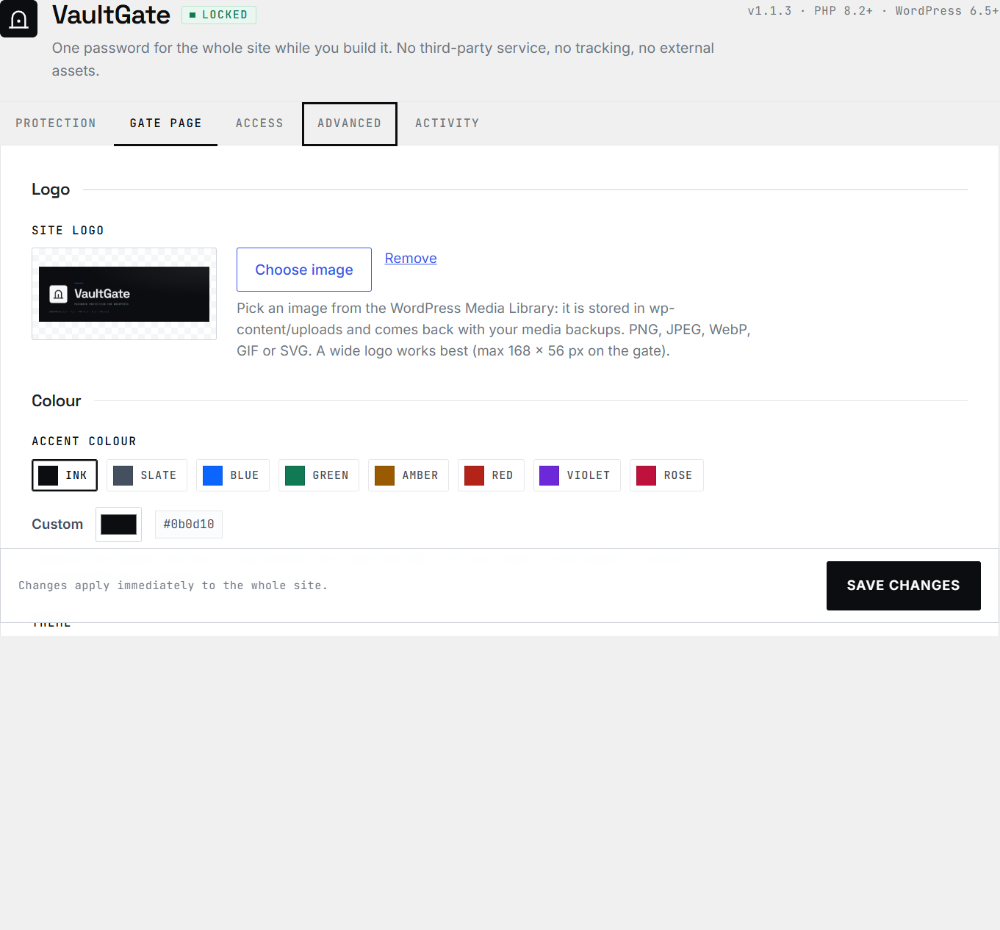
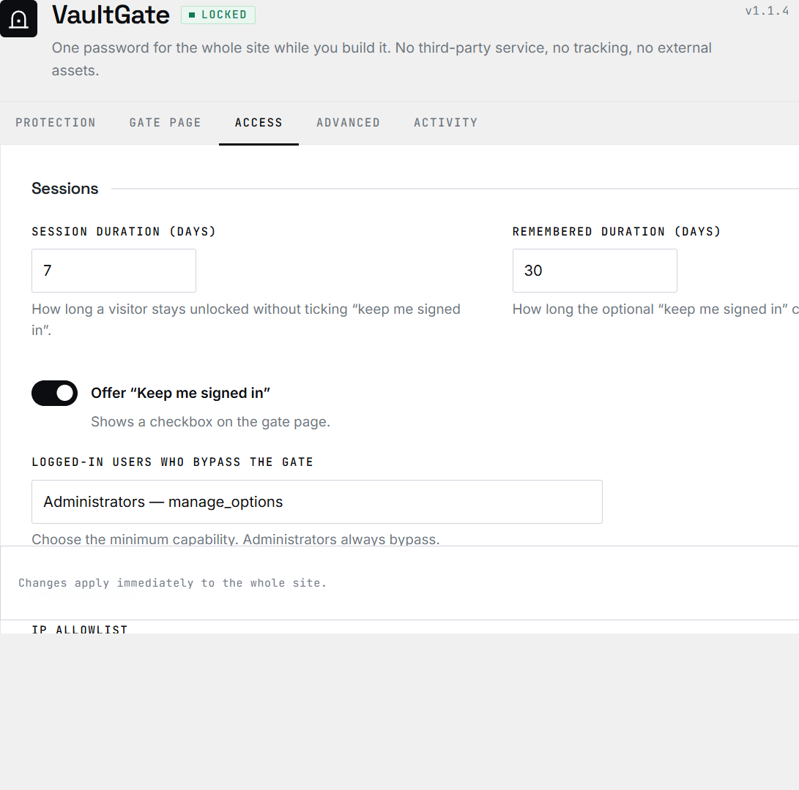
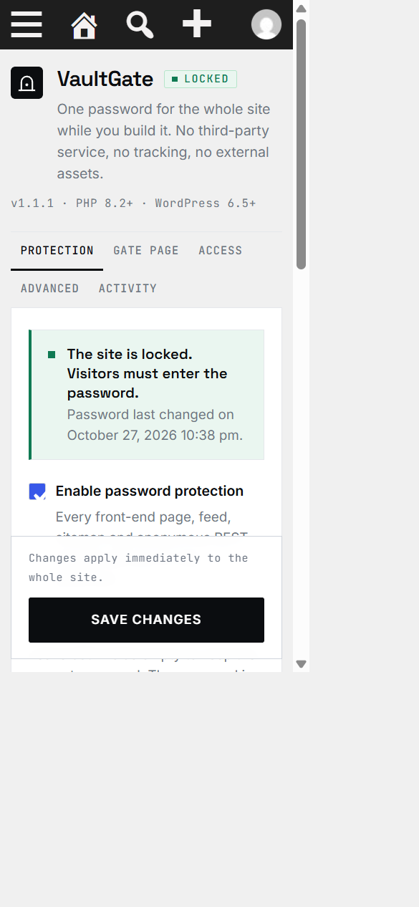

<p align="center">
  
</p>

<h1 align="center">VaultGate</h1>

<p align="center">
  <b>One password for the whole site — nothing else on the page.</b><br>
  A quiet WordPress plugin for sites that are still being built.
</p>

<p align="center">
  <a href="https://github.com/zigmoon/VaultGate/releases/latest"><b>⬇ Download</b></a> ·
  <a href="#the-gate">The gate</a> ·
  <a href="#install">Install</a> ·
  <a href="#security">Security</a> ·
  <a href="#credits">Credits</a>
</p>

<p align="center">
  
  
  
  
  
</p>

## The gate

| Light | Dark |
|---|---|
|  |  |

One column, centred from 320 px up. It works without JavaScript; the eye that reveals the password, the lock-out countdown and the caps-lock hint are progressive enhancement only.

## What you get

**Settings → VaultGate** — five tabs, no noise: **Protection**, **Gate page**, **Access**, **Advanced**, **Activity**.

- **One password, everything closed.** Pages, archives, feeds, sitemaps, the REST API, anonymous AJAX and XML-RPC — each with its own switch.
- **Your logo, your colour.** Logo picked from the Media Library (`wp-content/uploads`), eight accent swatches or any hex, light / dark / system gate. Button contrast is computed, never guessed.
- **Your favicon, even on the gate.** The browser tab keeps the WordPress Site Icon; a site that never set one falls back to the VaultGate mark instead of a blank tab.
- **Switches, not checkboxes.** Every on/off setting is a real switch — native input, keyboard-navigable, exposed as `role="switch"`.
- **Nothing you did not write.** No marketing sentence, no support link, no footer on the gate. A logo, a title, a field, a button.
- **No third party.** Fonts, icons and styles live inside the plugin. No Google Fonts, no CDN, no analytics. The only outbound request is the update check against GitHub, once every 12 hours, and it has a switch.
- **Built to be removed.** No table, no `.htaccess`, no rewrite rule. Deactivate and the site is public again.
- **English, French, Spanish.** Source strings in English; the interface follows the site language.

## The settings screen

| Protection | Gate page | Access |
|---|---|---|
| [](docs/admin-protection.png) | [](docs/admin-gate.png) | [](docs/admin-access.png) |

Click a panel for the full-size view.

**Advanced** holds the surface switches (REST, feeds, sitemaps, AJAX, XML-RPC), the brute-force limits and the cleanup options; **Activity** lists the last 20 events.

## Security

- **Password** — `wp_hash_password()` / `wp_check_password()`. Never stored in clear text, never logged, never sent anywhere.
- **Cookie** — `expiry.signature`, HMAC-SHA256 over the expiry, the session version and the site's `COOKIEHASH`, keyed with `wp_salt('auth')`. Compared with `hash_equals()`.
- **Revocation** — changing the password, toggling protection or pressing "Sign out every visitor" bumps the session version: every issued cookie dies immediately.
- **Cookie attributes** — `HttpOnly`, `SameSite=Lax`, `Secure` on HTTPS (or behind a trusted proxy), WordPress path and domain.
- **Brute force** — sliding window per visitor, keyed by an HMAC of the address; escalating lock-out with a live countdown.
- **Real visitor address** — forwarded headers are ignored unless the direct peer is one of your configured proxies. When it is, the `X-Forwarded-For` chain is read from the right, so a spoofed entry cannot pass for the visitor or dodge the rate limit.
- **Form** — expiring signed token, hidden honeypot, one generic error message, `303` redirect after POST so a refresh cannot replay it.
- **Direct endpoints** — `wp-comments-post.php`, `wp-trackback.php`, `wp-signup.php`, `wp-activate.php`, `wp-mail.php` and `wp-admin/admin-post.php` are blocked before WordPress runs, including behind PATH_INFO or a dot-segment path.
- **Headers** — `no-store`, `noindex, nofollow, noarchive`, `X-Frame-Options: DENY`, `nosniff`, `Referrer-Policy: no-referrer`, restrictive `Permissions-Policy`, and a Content-Security-Policy with a per-request nonce and no `unsafe-inline`.
- **Admin** — `manage_options`, a nonce on every action, server-side validation, escaped output everywhere, `wp_safe_redirect()` for every redirect.
- **Least data** — one option array, one hash, one small log with anonymised IP addresses.

## Install

1. Download `VaultGate-1.1.9.zip` from [Releases](https://github.com/zigmoon/VaultGate/releases/latest).
2. **Plugins → Add New → Upload Plugin**, choose the ZIP, install, activate.
3. **Settings → VaultGate**: set the password, then turn protection on.

Or from a checkout:

```bash
cp -r VaultGate /path/to/wp-content/plugins/
wp plugin activate VaultGate
wp vaultgate password 'a long passphrase'
wp vaultgate enable
```

The folder must be named `VaultGate`. WordPress 6.5+ and PHP 8.2+ — nothing else to install. The first activation shows a single notice pointing at the password field.


## Compatibility

| | |
|---|---|
| WordPress | 6.5 → 7.1 (latest stable at the time of writing: 7.1.3) |
| PHP | 8.2 → 8.5 |
| Database | No table created; `wp_options` only |
| Multisite | Yes, settings per site |
| PHP extensions | None beyond a standard WordPress install |
| Browsers | Anything current; the gate works without JavaScript |

## Limits

- **Static files.** `wp-content/uploads/...` is served by the web server and never reaches WordPress. Use server authentication for sensitive files.
- **Page cache.** The gate sends `no-store` and checks the cookie on every request; exclude the site from an external full-page cache while it is locked.
- **CDN address.** Behind a CDN or load balancer, list its addresses under **Trusted proxies**. Left empty, only a loopback or private peer is trusted, so every visitor is seen as the CDN and shares one rate-limit bucket.
- **`wp-login.php` stays open.** It is the way back in: administrator sessions always bypass the gate.
- **One shared password.** Not a user or role manager.

## Removing it

Deactivating makes the site public again and revokes every issued cookie. Deleting the plugin removes its settings, hash and log — **on by default** — so nothing is left behind. If you ever get stuck: `define( 'VAULTGATE_DISABLED', true );` in `wp-config.php`, or `wp vaultgate disable`.

## Updates

The plugin lives on GitHub, not in the WordPress.org directory, so it brings its own update check. It declares `Update URI` — the header WordPress 5.8 added for exactly this — and answers the filter core then calls; the new version appears on **Plugins** and **Updates**, "Update now" installs it, and automatic updates can be enabled like any other plugin.

- The check runs at most once every 12 hours, and the answer is cached in a site transient. A failed check is cached for an hour, so an offline site never waits on a timeout.
- **Settings → VaultGate → Advanced → "Check GitHub for updates"** switches it off. Off means no request at all.
- A release is only offered when it is a real release (not a draft, not a pre-release) and carries an installable ZIP. The complete-project archive is never offered.

## Quality

- **Latest WordPress, latest PHP.** WordPress 6.5 → 7.1, PHP 8.2 → 8.5, no deprecated call, no bundled library. Translations load on `init`, as WordPress 6.7+ requires.
- **262 assertions.** Two suites on PHP 8.3 and 8.5, with no WordPress installation: `210 passed, 0 failed` and `52 passed, 0 failed`.
- **Checked on a real install.** Every surface probed on WordPress 7.1.3 / PHP 8.3: front, posts, feeds, sitemaps, REST, AJAX, XML-RPC, `robots.txt`, `wp-login.php`, admin, activation and deletion.
- **Responsive back office.** The settings screen holds up down to 360 px; the gate is centred at every width.



## Development

```bash
php tests/run.php                 # unit tests, including the release payload
php tests/smoke.php               # boot, guard, REST, admin render
php tools/build-translations.php  # .pot + fr_FR + es_ES, compiled and verified
pwsh -File tools/build-zip.ps1    # dist/VaultGate-<version>.zip, hash-verified
```

Expected output: `210 passed, 0 failed` and `52 passed, 0 failed`. The suites use a small set of WordPress stubs (`tests/bootstrap.php`): no database, no web server, no WordPress installation needed.

## Credits

A plugin by **[2.13](https://2points13.fr)** · dev by **[zigmoon](https://zigmoon.com)**.


GPL-2.0-or-later — see [LICENSE](LICENSE). Fonts: Inter, Space Grotesk, JetBrains Mono (SIL Open Font License, embedded). Security reports: [SECURITY.md](SECURITY.md).
