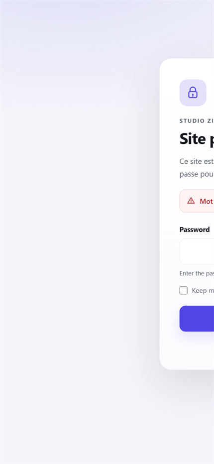
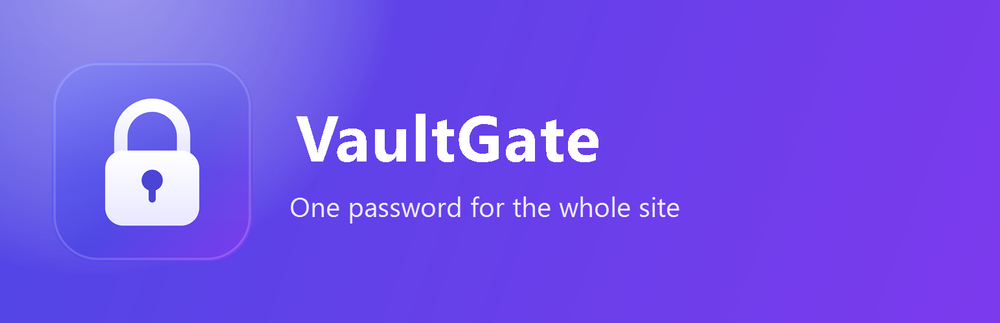

<p align="center">
  
</p>

<h1 align="center">VaultGate</h1>

<p align="center">
  <b>Un seul mot de passe pour tout un site WordPress.</b><br>
  Verrouillez l’intégralité du site pendant sa construction — sans service tiers, sans pistage, sans dépendance externe.
</p>

<p align="center">
  <a href="https://github.com/zigmoon/passwordprotect/releases/latest"><b>⬇️ Télécharger</b></a> ·
  <a href="#installation">Installation</a> ·
  <a href="#les-réglages">Réglages</a> ·
  <a href="#sécurité--comment-ça-marche">Sécurité</a> ·
  <a href="#développement">Développement</a>
</p>

<p align="center">
  
  
  
  
  
  
</p>

<p align="center">
  
</p>

---

## Sommaire

1. [Ce que fait l’extension](#1-ce-que-fait-lextension)
2. [Pourquoi elle est plus solide qu’une extension « simple »](#2-pourquoi-elle-est-plus-solide-quune-extension--simple-)
3. [Aperçus](#3-aperçus)
4. [Installation](#4-installation)
5. [Mise en route en 30 secondes](#5-mise-en-route-en-30-secondes)
6. [Les réglages](#6-les-réglages)
7. [Sécurité : comment ça marche](#7-sécurité--comment-ça-marche)
8. [Limites assumées](#8-limites-assumées)
9. [Accès d’urgence](#9-accès-durgence)
10. [WP-CLI](#10-wp-cli)
11. [Filtres pour les intégrations](#11-filtres-pour-les-intégrations)
12. [Développement](#12-développement)
13. [Structure du dépôt](#13-structure-du-dépôt)
14. [Compatibilité](#14-compatibilité)
15. [FAQ](#15-faq)
16. [Désinstallation](#16-désinstallation)
17. [Journal des versions](#17-journal-des-versions)
18. [Licence](#18-licence)
19. [English summary](#english-summary)

---

## 1. Ce que fait l’extension

VaultGate place une **page de garde** devant un site WordPress : tant que le mot de passe n’est pas saisi, rien d’autre n’est accessible.

| Surface | Comportement par défaut |
|---|---|
| Pages, articles, archives, page 404 | Page de garde |
| Flux RSS / Atom | Page de garde |
| Sitemaps (`wp-sitemap.xml`) | Page de garde |
| API REST (`/wp-json/…`) | `401` pour les visiteurs anonymes |
| AJAX anonyme (`admin-ajax.php`) | `401` pour les visiteurs anonymes |
| XML-RPC (`xmlrpc.php`) | `403` |
| Commentaires, trackbacks, `wp-mail.php`, `wp-signup.php`, `wp-activate.php`, `admin-post.php` | `403` |
| `robots.txt` | `User-agent: * / Disallow: /` |
| `wp-login.php`, `wp-admin` (utilisateur connecté), WP-Cron, WP-CLI | Toujours accessibles |

Tout est réglable : chaque surface peut être laissée ouverte depuis l’administration.

**Tout se pilote depuis Réglages → VaultGate** : changer le mot de passe, activer/désactiver la protection, déconnecter tous les visiteurs d’un clic, personnaliser la page de garde, gérer les exceptions.

---

## 2. Pourquoi elle est plus solide qu’une extension « simple »

| Point | Extensions minimalistes | VaultGate |
|---|---|---|
| Stockage du mot de passe | Parfois en clair, ou hachage maison | `wp_hash_password()` uniquement (bcrypt/Argon2 selon WordPress) |
| Session | Cookie non signé, mot de passe dans le cookie, session PHP | Jeton **HMAC-SHA256** signé, `HttpOnly`, `SameSite=Lax`, `Secure` en HTTPS |
| Révocation | Suppression cookie par cookie | **Version de session** : tous les cookies invalidés instantanément |
| Force brute | Aucune limite | Compteur **par visiteur**, blocage temporaire, messages génériques |
| Périmètre | Pages seulement | Pages, flux, sitemaps, REST, AJAX, XML-RPC, endpoints directs |
| Exceptions | Aucune | Capacité WordPress, IP/CIDR, chemins exclus avec joker |
| Page de garde | Formulaire HTML brut | Page autonome, responsive, accessible, thèmes clair/sombre/auto |
| En-têtes | Aucun | `no-store`, `X-Robots-Tag`, `X-Frame-Options`, `nosniff`, `Referrer-Policy`, `Permissions-Policy`, **CSP à nonce** |
| Administration | Un champ texte | 5 onglets, aperçu, validation, journal d’activité |
| Internationalisation | Anglais uniquement | Anglais source + **traduction française complète** |
| Secours | Aucun | WP-CLI, constante `VAULTGATE_DISABLED`, désinstallation propre |
| Qualité | Peu ou pas de tests | **139 assertions** exécutées sous PHP 8.3 et PHP 8.5 |
| Empreinte | jQuery, polices, CDN | **Zéro dépendance**, zéro requête externe, zéro pistage |

---

## 3. Aperçus

| Thème clair | Thème sombre |
|---|---|
|  |  |

| Mobile |
|---|
|  |

<p align="center">
  
</p>

---

## 4. Installation

### Depuis l’archive (recommandé)

1. Télécharger [`dist/vaultgate-1.0.0.zip`](dist/vaultgate-1.0.0.zip).
2. Dans WordPress : **Extensions → Ajouter → Téléverser une extension**.
3. Activer **VaultGate**.
4. Ouvrir **Réglages → VaultGate**.

### Par FTP / SSH

Copier le dossier [`vaultgate/`](vaultgate/) dans `wp-content/plugins/`, puis activer l’extension.

### WP-CLI

```bash
wp plugin activate vaultgate
wp vaultgate password 'une longue phrase secrète'
wp vaultgate enable
```

### Prérequis

- WordPress **6.5** ou plus récent.
- PHP **8.2** ou plus récent (aucune extension PHP supplémentaire n’est requise).

---

## 5. Mise en route en 30 secondes

1. **Réglages → VaultGate → Protection**.
2. Saisir un mot de passe (**8 caractères minimum**) et le confirmer.
3. Cocher **Activer la protection par mot de passe**.
4. **Enregistrer les modifications**.
5. Ouvrir le site dans une fenêtre de navigation privée : la page de garde doit apparaître.

> **Pourquoi l’activation est-elle refusée sans mot de passe ?**
> Pour qu’il soit impossible de verrouiller un site sans moyen d’entrer. L’extension désactive alors la protection et affiche une erreur explicite.

> **Vous êtes bloqué ?** `wp-login.php` reste toujours accessible, et `define( 'VAULTGATE_DISABLED', true );` dans `wp-config.php` désactive la page de garde en une ligne. Voir [Accès d’urgence](#9-accès-durgence).

---

## 6. Les réglages

### Onglet « Protection »

| Réglage | Effet |
|---|---|
| Activer la protection | Interrupteur général. Sans mot de passe enregistré, l’extension refuse de l’activer. |
| Nouveau mot de passe + confirmation | Laisser les deux champs vides pour conserver le mot de passe actuel. Minimum 8 caractères. |
| Déconnecter tous les visiteurs | Invalide immédiatement tous les cookies émis. Votre session d’administration n’est pas affectée. |

Le bandeau de statut rappelle en permanence si le site est verrouillé et la date du dernier changement de mot de passe.

### Onglet « Page de garde »

| Réglage | Effet |
|---|---|
| Titre | Titre principal et titre de l’onglet du navigateur. |
| Message | Texte d’introduction. HTML simple autorisé (liens, gras, retours à la ligne). |
| URL du logo | Facultatif. Remplacé par l’icône de cadenas intégrée si vide. |
| Couleur d’accent | Bouton, anneaux de focus, halos. Le contraste du texte du bouton est calculé automatiquement (WCAG). |
| Thème | Automatique (suit le système du visiteur), clair ou sombre. |
| Lien d’assistance | Lien « Besoin d’un accès ? » sous le formulaire (`https://…` ou `mailto:…`). |
| Note de pied de page | Petit texte sous la carte. Le nom du site est utilisé si vide. |

### Onglet « Accès »

| Réglage | Effet |
|---|---|
| Durée de session | 1 à 365 jours. Valeur par défaut : 7. |
| Durée « Rester connecté » | 1 à 365 jours, utilisé si la case est cochée. Valeur par défaut : 30. |
| Proposer « Rester connecté » | Affiche la case à cocher sur la page de garde. |
| Utilisateurs connectés qui contournent | Administrateurs (défaut), éditeurs, auteurs, ou tout utilisateur connecté. Les administrateurs contournent dans tous les cas. |
| Liste d’IP autorisées | Une IP ou une plage CIDR par ligne (IPv4 et IPv6). Ces visiteurs ne voient jamais la page de garde. |
| Faire confiance aux en-têtes du proxy | Lit `X-Forwarded-For` / `X-Forwarded-Proto`. **À n’activer que derrière un proxy maîtrisé** : sur un serveur directement exposé, cela permet d’usurper son IP. |
| Chemins exclus | Un chemin par ligne ; `*` est un joker. Un chemin couvre ses sous-chemins. Utile pour les contrôles de santé, les webhooks de paiement ou une API publique. |

### Onglet « Avancé »

| Réglage | Effet |
|---|---|
| API REST | `401` pour les requêtes anonymes `/wp-json`. |
| Flux | Les flux RSS/Atom passent par la page de garde. |
| Sitemaps | `wp-sitemap.xml` et ses enfants passent par la page de garde. |
| AJAX anonyme | `admin-ajax.php` renvoie `401` sans cookie valide. |
| XML-RPC | `xmlrpc.php` renvoie `403`. |
| Tentatives avant blocage | 1 à 50, par visiteur. Défaut : 5. |
| Durée du blocage | 1 à 1440 minutes. Défaut : 15. |
| Journal d’activité | Conserve les 20 derniers événements, avec IP anonymisées. |
| Supprimer les données à la désinstallation | Options, hachage, journal et transients. Désactivé par défaut. |

### Onglet « Activité »

Les 20 derniers événements : connexions réussies ou refusées, blocages, changements de mot de passe, réglages enregistrés, requêtes REST/AJAX/XML-RPC bloquées.
**Aucun mot de passe n’y est écrit.** Les adresses IP sont anonymisées avec `wp_privacy_anonymize_ip()`.

---

## 7. Sécurité : comment ça marche

- **Mot de passe** — `wp_hash_password()` / `wp_check_password()`. Aucun mot de passe en clair n’est stocké, journalisé ou transmis ailleurs. La longueur est comptée en caractères (UTF-8), pas en octets.
- **Cookie** — valeur `expiration.signature`. La signature est un `HMAC-SHA256` calculé sur `contexte | version de session | expiration`, avec `wp_salt('auth')` et l’identité du site (`COOKIEHASH`). Toute altération invalide le jeton (`hash_equals`).
- **Révocation globale** — changer le mot de passe, activer/désactiver la protection ou cliquer sur « Déconnecter tous les visiteurs » incrémente `vaultgate_auth_version` : tous les cookies existants deviennent invalides, sans base de sessions.
- **Attributs du cookie** — `HttpOnly`, `SameSite=Lax`, `Secure` lorsque HTTPS est détecté (ou annoncé par un proxy de confiance), chemin et domaine WordPress.
- **Anti-force brute** — compteur à fenêtre glissante par visiteur, stocké en transient. La clé du transient est un HMAC de l’adresse, jamais l’adresse en clair. Blocage après N échecs, puis déblocage automatique. Le bouton de la page de garde affiche un compte à rebours.
- **Formulaire** — jeton signé avec expiration (12 h), champ piège invisible (honeypot), messages d’erreur génériques, redirection `303` après traitement.
- **En-têtes de la page de garde** — `Cache-Control: no-store`, `Pragma: no-cache`, `X-Robots-Tag: noindex, nofollow, noarchive`, `X-Frame-Options: DENY`, `X-Content-Type-Options: nosniff`, `Referrer-Policy: no-referrer`, `Permissions-Policy` restrictive et **Content-Security-Policy** avec nonce par requête. Les origines du site et du dossier d’extensions sont autorisées explicitement (utile en `www` + CDN).
- **Administration** — capacité `manage_options`, nonces WordPress sur chaque action, validation serveur, échappement systématique à la sortie, aucun secret réaffiché.
- **Vie privée** — aucune ressource externe, aucune police distante, aucun script tiers, aucun appel réseau. Le journal est local, optionnel et anonymisé.

---

## 8. Limites assumées

Un plugin ne peut pas tout : ces limites sont réelles et documentées.

- **Fichiers statiques** — les fichiers servis directement par le serveur web (par exemple `wp-content/uploads/2024/01/photo.jpg`) ne passent pas par WordPress. Utilisez une protection serveur (`.htpasswd`) ou un stockage privé si ces fichiers sont sensibles.
- **Cache pleine page / CDN** — l’extension envoie `no-store`, `DONOTCACHEPAGE` et `DONOTCACHEOBJECT`, et vérifie le cookie à chaque requête. Mais un cache externe mal configuré peut servir une page en cache : excluez le site (ou le HTML dynamique) de son cache pendant la construction.
- **`wp-login.php` reste ouvert** — c’est nécessaire pour que l’administrateur puisse entrer. VaultGate est une porte d’entrée publique, pas un remplacement de l’authentification WordPress.
- **Un mot de passe partagé** — ce n’est ni une gestion d’utilisateurs, ni une gestion de rôles. Pour des comptes individuels, utilisez WordPress lui-même.
- **Multisite** — un réglage par site (pas de réglage réseau partagé).
- **API REST** — la protection bloque toutes les requêtes anonymes, y compris les webhooks qui ne s’authentifient pas. Ajoutez leurs chemins aux exceptions ou désactivez la protection REST.

---

## 9. Accès d’urgence

Trois filets de sécurité, indépendants :

1. **`wp-login.php`** n’est jamais filtré : un administrateur peut toujours se connecter, et sa session contourne la page de garde.
2. **Constante d’urgence**, sans toucher à la base :
   ```php
   define( 'VAULTGATE_DISABLED', true );
   ```
3. **WP-CLI** :
   ```bash
   wp vaultgate status
   wp vaultgate disable
   wp vaultgate password 'nouvelle phrase secrète'
   wp vaultgate logout-all
   ```

Déconnexion d’un visiteur : `https://exemple.com/?vaultgate=logout`.

---

## 10. WP-CLI

```text
wp vaultgate status        Affiche l’état complet (protection, mot de passe, surfaces, capacité)
wp vaultgate enable        Active la protection (un mot de passe doit exister)
wp vaultgate disable       Désactive la protection sans effacer le mot de passe
wp vaultgate password <mdp>  Définit le mot de passe (8 caractères minimum)
wp vaultgate password --stdin  Lit le mot de passe depuis l’entrée standard
wp vaultgate logout-all    Révoque tous les cookies émis
wp vaultgate log           Affiche le journal d’activité
wp vaultgate log --clear   Efface le journal
```

---

## 11. Filtres pour les intégrations

| Filtre | Rôle |
|---|---|
| `vaultgate_should_gate` | Autoriser ou refuser la page de garde pour une requête donnée. |
| `vaultgate_client_ip` | Remplacer l’IP détectée (utile pour un proxy maison). |
| `vaultgate_bypass_capabilities` | Ajouter ou retirer des capacités de contournement. |
| `vaultgate_blocked_endpoints` | Modifier la liste des endpoints directs bloqués. |
| `vaultgate_secure_cookie` | Forcer ou désactiver l’attribut `Secure`. |
| `vaultgate_cookie_name` | Renommer le cookie. |
| `vaultgate_throttled_log_events` | Choisir les événements limités à une entrée par minute. |
| `vaultgate_log_size` | Nombre d’entrées conservées (20 par défaut). |

Exemple — laisser passer un webhook de paiement sans ouvrir tout le site :

```php
add_filter(
	'vaultgate_should_gate',
	static function ( bool $gate ): bool {
		return str_starts_with( $_SERVER['REQUEST_URI'] ?? '', '/webhooks/stripe' ) ? false : $gate;
	}
);
```

---

## 12. Développement

Aucun gestionnaire de dépendances : PHP 8.2+ suffit.

```bash
# Tests unitaires : réglages, hachage, jetons, règles d’accès, limitation, rendu
php tests/run.php

# Test d’intégration : démarrage de l’extension, guard, REST, administration
php tests/smoke.php

# Régénère vaultgate.pot, vaultgate-fr_FR.po et vaultgate-fr_FR.mo
php tools/build-translations.php

# Aperçu local de la page de garde sur http://127.0.0.1:8450
php -S 127.0.0.1:8450 tests/preview-router.php

# Régénère les icônes, bannières et l’aperçu social depuis assets/icon-master.png
pwsh -File tools/build-images.ps1

# Fabrique l’archive installable
pwsh -File tools/build-zip.ps1
```

Résultat attendu des tests :

```text
116 passed, 0 failed
23 passed, 0 failed
```

Les tests s’exécutent sous **PHP 8.3.36** et **PHP 8.5.12**. Ils utilisent un jeu de fonctions WordPress simulées (`tests/bootstrap.php`) : aucune base de données, aucun serveur web, aucune installation WordPress n’est nécessaire.

### Fabriquer l’archive à la main

```powershell
Compress-Archive -Path .\vaultgate -DestinationPath .\dist\vaultgate-1.0.0.zip -Force
```

L’archive doit contenir un dossier `vaultgate/` à sa racine : `vaultgate.php`, `includes/`, `assets/`, `templates/`, `languages/` et `uninstall.php`.

---

## 13. Structure du dépôt

```text
passwordprotect/
├── vaultgate/                      ← le plugin, tel qu’il doit être installé
│   ├── vaultgate.php               en-tête WordPress + amorçage
│   ├── uninstall.php               nettoyage optionnel, compatible multisite
│   ├── readme.txt                  fiche WordPress.org (anglais)
│   ├── includes/
│   │   ├── class-plugin.php        câblage des composants
│   │   ├── class-settings.php      options, valeurs par défaut, assainissement
│   │   ├── class-access-rules.php  IP, CIDR, chemins, HTTPS (fonctions pures)
│   │   ├── class-token.php         jetons signés HMAC (cookie + formulaire)
│   │   ├── class-rate-limiter.php  limitation par visiteur
│   │   ├── class-guard.php         décisions d’accès et rendu de la page de garde
│   │   ├── class-admin.php         écran de réglages, notices, journal
│   │   └── class-cli.php           commandes WP-CLI
│   ├── templates/gate.php          page de garde (HTML autonome)
│   ├── assets/css|js/              styles et scripts locaux (aucun CDN)
│   └── languages/                  .pot, fr_FR .po et .mo compilé
├── assets/                         icônes, bannières, aperçu social
├── docs/                           captures d’écran
├── dist/                           archive installable versionnée
├── tests/                          suite de tests + aperçu local
└── tools/                          génération des traductions, images, archive
```

---

## 14. Compatibilité

| Élément | Plage testée |
|---|---|
| WordPress | 6.5 → 7.1 (dernière stable au 27/10/2026 : **7.1.3**) |
| PHP | 8.2 → 8.5 (exécution des tests sous **8.3.36** et **8.5.12**) |
| Base de données | Aucune table créée ; uniquement `wp_options` |
| Multisite | Oui (réglages par site, nettoyage par site) |
| Extensions PHP requises | Aucune en plus du cœur de WordPress |
| Navigateurs | Toute version supportée ; la page de garde fonctionne **sans JavaScript** |

Le code n’utilise que des API WordPress maintenues, aucune fonction dépréciée en PHP 8.4/8.5, et aucun `eval`, aucune requête HTTP sortante.

---

## 15. FAQ

**Le mot de passe est-il stocké en clair ?**
Non. Seul un hachage produit par `wp_hash_password()` est enregistré.

**J’ai oublié le mot de passe, que faire ?**
Connectez-vous par `wp-login.php` (les administrateurs contournent la page de garde), ou utilisez `VAULTGATE_DISABLED`, ou `wp vaultgate password '…'`.

**Est-ce compatible avec un cache pleine page ?**
Oui pour les en-têtes et la vérification du cookie, mais excluez le site du cache tant qu’il est verrouillé : un cache externe mal configuré peut servir une version en cache.

**Les fichiers téléversés sont-ils protégés ?**
Non. Ils sont servis par le serveur web sans passer par WordPress. Voir [Limites assumées](#8-limites-assumées).

**Puis-je laisser passer Google Analytics ou un webhook ?**
Oui : ajoutez le chemin aux exceptions, ou utilisez `vaultgate_should_gate`.

**Que se passe-t-il si je désactive l’extension ?**
Le site redevient public. Tous les cookies émis sont révoqués, donc réactiver l’extension redemande le mot de passe.

**La page de garde est-elle accessible ?**
Oui : HTML sémantique, lien d’évitement, focus visibles, champ correctement étiqueté, erreur en `role="alert"`, prise en charge de `prefers-reduced-motion`, contraste AA, et fonctionnement complet sans JavaScript.

**Puis-je l’utiliser sur un site en sous-dossier ?**
Oui. Les chemins exclus sont comparés relativement au dossier d’installation (`/blog`).

---

## 16. Désinstallation

1. **Extensions → Désactiver** : la protection s’arrête, les cookies sont révoqués, les réglages sont conservés.
2. **Supprimer** : si l’option « Supprimer toutes les données » a été cochée, les options, le hachage, le journal et les transients sont effacés (site par site en multisite). Sinon, rien n’est supprimé.

---

## 17. Journal des versions

Voir [CHANGELOG.md](CHANGELOG.md).

---

## 18. Licence

**GPL-2.0-or-later** — voir [LICENSE](LICENSE).
Copyright © 2026 zigmoon.

Signaler une vulnérabilité : [SECURITY.md](SECURITY.md).

---

## English summary

**VaultGate** password-protects an entire WordPress site with a single shared password. It ships a standalone, accessible gate page; signed `HttpOnly` cookies that can be revoked globally in one click; per-visitor brute-force throttling; IPv4/IPv6/CIDR allowlists; path exclusions; and switches for REST, feeds, sitemaps, anonymous AJAX and XML-RPC. Everything is configured under **Settings → VaultGate**.

- Requires WordPress 6.5+ and PHP 8.2+ (tested on WordPress 7.1 / PHP 8.5).
- No third-party service, no tracking, no external assets, no Composer or npm build.
- Password stored with `wp_hash_password()`; sessions are HMAC-signed cookies, never stored server-side.
- 139 automated assertions across two suites; French translation included.
- Static files served directly by the web server cannot be protected by a plugin — see [Limites assumées](#8-limites-assumées).

Install from [`dist/vaultgate-1.0.0.zip`](dist/vaultgate-1.0.0.zip), activate, then set a password under **Settings → VaultGate**.
